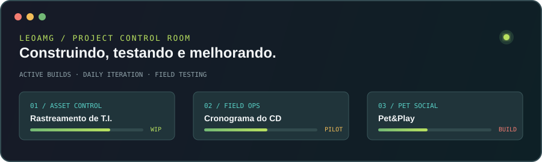

Transformando problemas da operação em soluções claras, rastreáveis e úteis para quem está no campo.

## Sobre mim

Sou Leonardo Antônio Magalhães Gonçalves, desenvolvedor fullstack em Salvador, Bahia. Construo software a partir de problemas reais da operação: identifico o que trava o trabalho, desenho o fluxo e construo a ferramenta que resolve, seja uma automação, uma aplicação web ou um ajuste de infraestrutura.

Este perfil é o meu portfólio. Cada projeto abaixo descreve o problema que motivou a solução, como ela foi construída e em que estágio está.

## Projetos em destaque

<table>
<tr>
<td width="50%" valign="top">

### ⚡ [PostEngineAI](https://github.com/leomagalhaesti/Postengine-ai)

`EM PRODUÇÃO`

**Problema:** manter publicações constantes no LinkedIn exigia escrever, buscar imagem e postar manualmente todos os dias.

**Solução:** pipeline no n8n que roda todos os dias, escreve o post com IA, valida o texto, escolhe uma foto inédita, publica no LinkedIn e registra o histórico no Notion.

**Destaques técnicos:** saída estruturada do modelo com etapa de validação, histórico de fotos e temas para evitar repetição, upload binário de mídia para a API do LinkedIn.

</td>
<td width="50%" valign="top">

### 📦 [TrackPoint](https://github.com/leomagalhaesti/trackpoint)

`PILOTO`

**Problema:** em períodos de alta demanda, a conferência de equipamentos de T.I. que entram e saem do Centro de Distribuição era feita à mão, antes do lançamento no sistema oficial.

**Solução:** aplicação web para controle de estoque, preparação, conferência e retorno de equipamentos, publicada como site estático.

**Destaques técnicos:** leitura e geração de QR Code, exportação de relatórios em PDF, validação de formulários com Zod e testes com Vitest.

</td>
</tr>
</table>

## Em desenvolvimento

<table>
<tr>
<td width="50%" valign="top">

### Cronograma TV

`PILOTO ATIVO`

Painel operacional para agenda, controle de campo, SQLite, histórico, PAT + modelo e exportação.

</td>
<td width="50%" valign="top">

### Pet&Play

`EM EVOLUÇÃO`

Produto digital para socialização responsável, segurança, saúde e encontros entre pets e tutores.

</td>
</tr>
</table>

Projetos-piloto mudam com frequência durante os ciclos de teste e ainda não têm repositório público.

## Stack

| Área | Tecnologias |
|---|---|
| **Automação e IA** |     |
| **Desenvolvimento** |      |
| **Dados** |   |
| **Infraestrutura** |     |
| **Segurança** |   |

## Contribuições

<picture>
  <source media="(prefers-color-scheme: dark)" srcset="https://raw.githubusercontent.com/leomagalhaesti/leomagalhaesti/output/github-contribution-grid-snake-dark.svg" />
  
</picture>

### Construindo tecnologia para tornar a operação mais clara.

> Projetos-piloto podem conter código e ideias proprietárias. Consulte o `LICENSE` de cada repositório antes de reutilizar qualquer conteúdo.
